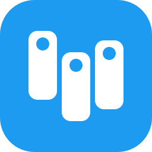

# XDeck

[](LICENSE)
[](https://github.com/sadik-malik/XDeck/releases/latest)



A multi-column 𝕏, Instagram and Facebook client for macOS, Windows and Linux, a TweetDeck alternative. XDeck shows each site as it is, in columns side by side. It is not affiliated with X Corp. or Meta.

[Download](https://github.com/sadik-malik/XDeck/releases/latest) · [Website](https://sadik-malik.github.io/XDeck/)


## Installation

Download from [Releases](https://github.com/sadik-malik/XDeck/releases/latest):

- **macOS:** `XDeck-X.Y.zip` (universal: Apple Silicon and Intel). Unzip and move `XDeck.app` to Applications. XDeck isn't notarized by Apple, so macOS blocks the first launch ("Apple could not verify XDeck…"): click **Done**, then open **System Settings → Privacy & Security**, scroll to Security and click **Open Anyway** next to XDeck, and confirm. Or run `xattr -dr com.apple.quarantine /Applications/XDeck.app` once in Terminal. After an update, macOS may ask once whether XDeck can use its "XDeck Safe Storage" keychain item (where your logins are encrypted): choose **Always Allow**.
- **Windows:** `XDeck-Setup-X.Y.exe`. The installer isn't code-signed, so Windows SmartScreen may show "Windows protected your PC": choose **More info → Run anyway**.
- **Linux:** `XDeck-X.Y-x86_64.AppImage` (make it executable and run it) or `XDeck-X.Y-amd64.deb`.

XDeck checks for a newer release from its settings menu (⚙ on the left bar → About → Check for Updates…).

## Getting started

XDeck opens on a welcome screen. Choose **Add X account**, **Add Instagram account** or **Add Facebook account** and log in in the window that opens, with your user name, email or phone and password. Google and Apple sign-in (X) and Log in with Facebook (Instagram) don't work inside XDeck; Facebook's own security checks (a code, "was this you?") work in the window. There is no login screen after that: XDeck remembers your accounts and opens straight to your columns.

A column whose account isn't logged in says so and shows a **Log in** button, which opens the same window.

## Columns

The bar on the left works like TweetDeck's: **Post**, **Search** (adds a search column), a button for each column (click to bring it into view), **Add column**, and at the bottom your accounts (…) and XDeck's settings (⚙: Dark Mode, Desktop Notifications, zoom, Reload All Columns, Fit Window to Columns, Reset Layout, User Agent, Keyboard Shortcuts, About). On Windows and Linux there is no menu bar: everything is on the left bar. On macOS the same items are also in the app menu.

- **Add a column:** **Add column** on the left bar (`⌘T` / `Ctrl+T`), or a column's `⋯` menu → Add Column to the Right…. From X: For you, Following, Notifications, Mentions, your profile, a search, a user, a list, Bookmarks, Messages or Explore. From Instagram: Feed, Reels, Explore, Notifications, Messages, your profile, Saved, a user or a hashtag. From Facebook: Feed, Notifications, Video, Groups, a group, a Page or person, Marketplace, Events, your profile or Saved. Any other web page can be added in `settings.json` as a `custom` column.
- **Each column's header** shows its icon and title. Click it to scroll back to the top, drag it to reorder, and use its `⋯` menu to reload, filter or remove the column.
- **Resize** a column by dragging its right edge. Reset Layout (⚙) restores the `settings.json` order and widths.

Columns you add or remove are saved to `settings.json`.

**Decks:** the tiles at the top of the left bar are decks: separate sets of columns, like TweetDeck's. The **+** tile below them adds one; click the open deck's tile to rename or delete it. Only the open deck's columns are loaded. With more than one deck, `settings.json` lists them under `decks`:

```json
{
  "decks": [
    { "name": "Main", "columns": [{ "type": "forYou" }, { "type": "notifications" }] },
    { "name": "News", "columns": [{ "type": "custom", "url": "https://x.com/search?q=news&f=live" }] }
  ]
}
```

**Column filters:** a column's `⋯` menu → Filters…, for that column only. X columns can hide reposts, show only posts with photos or videos, or mute words; a post you open in a filtered X column shows its whole conversation. Instagram and Facebook columns can hide Reels or mute words.

**Keyboard shortcuts** (like TweetDeck's; not while typing): `1`–`9` go to that column, `N` new post, `/` search, `?` lists them (also ⚙ → Keyboard Shortcuts). Inside a column, X's own keys still work (`j`/`k`, `l`, `r`, `t`).

**Accounts:** the left bar's accounts menu (…) lists every account, each with its own settings and a remove button (removing an account logs it out of XDeck), and adds more: **Add X account…**, **Add Instagram account…** and **Add Facebook account…**. Each account has its own session. With more than one account on a network, adding a column asks which account it shows, and the column header names it; a column's account is saved in `settings.json` as `"account": "username"`. **Post** posts as your only account, or asks which one: X opens X's post editor, Instagram and Facebook open their own new-post window.

**Instagram:** one or more Instagram accounts, each in its own session, never shared with X. Instagram columns hide Instagram's own top and bottom bars (the left bar is the navigation) and follow XDeck's Dark Mode. They are saved in `settings.json` as `custom` columns with their Instagram address, so any Instagram link works as a column.

**Facebook:** one or more Facebook accounts, each in its own session, named by their name on Facebook. Facebook columns hide Facebook's top bar, and links you open go to your browser as the page they lead to. Messenger is not supported: there is no Messages column, and calls don't work. Facebook follows XDeck's Dark Mode when its own dark mode setting is Automatic. Facebook columns are saved in `settings.json` as `custom` columns with their Facebook address; a Facebook column's account is its numeric user id.

**Desktop notifications:** when an account's unread count goes up while XDeck is in the background (X's notifications, or Instagram's or Facebook's count), XDeck shows a notification (and a badge on macOS and Linux). Click it to jump to that site's Notifications column. Turn it off with ⚙ → Desktop Notifications.

## Configuration

`settings.json` is in `~/.config/XDeck/` on every OS, next to `schema.json`, which editors use to check it. Edit it in any editor and restart XDeck. Column types are `forYou`, `following`, `notifications`, `profile` and `custom` (any http or https address); `columnWidth` sets every column's width in pixels (leave it out to fill the window).

Example

```json
{
  "$schema": "./schema.json",
  "columnWidth": 380,
  "columns": [
    { "type": "following" },
    { "type": "forYou" },
    { "type": "notifications" },
    {
      "type": "custom",
      "url": "https://x.com/i/lists/123456789",
      "filters": { "hideReposts": true, "mutedWords": ["spoiler"] }
    },
    {
      "type": "custom",
      "url": "https://www.instagram.com/",
      "filters": { "hideReels": true }
    },
    { "type": "custom", "url": "https://www.facebook.com/groups/feed/" }
  ]
}
```

## Development

Requires Node 24 and pnpm.

```sh
pnpm install      # also sets up the git hooks (lefthook)
pnpm dev          # run the app
pnpm lint         # Biome; pnpm format fixes
pnpm typecheck
pnpm dist:win     # or dist:mac / dist:linux: build installers into dist/
```

Before each commit, the git hooks run Biome on the staged files and the typecheck.

End-to-end tests run against the real sites with test accounts: log in once with `pnpm e2e:login` (Add X account on the welcome screen; the Instagram and Facebook specs also need those test accounts, added from the accounts menu), then run `pnpm test:e2e`. `XDECK_E2E_OFFLINE=1 pnpm test:e2e` runs only the specs that need no login.

**Releases** are built by the Release workflow, started by hand: Actions → Release → Run workflow with the version (`MAJOR.MINOR`, like `1.0`), or `gh workflow run release.yml -f version=1.0`. It builds macOS, Windows and Linux and publishes them as one GitHub release. The website in `public/` is published to GitHub Pages by the Landing page workflow.
